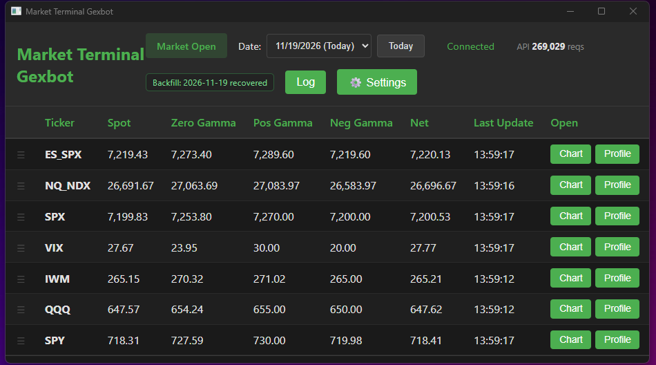
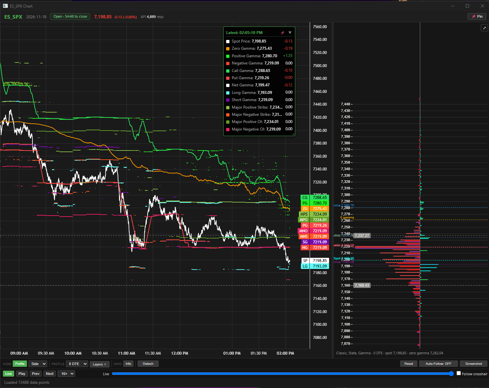
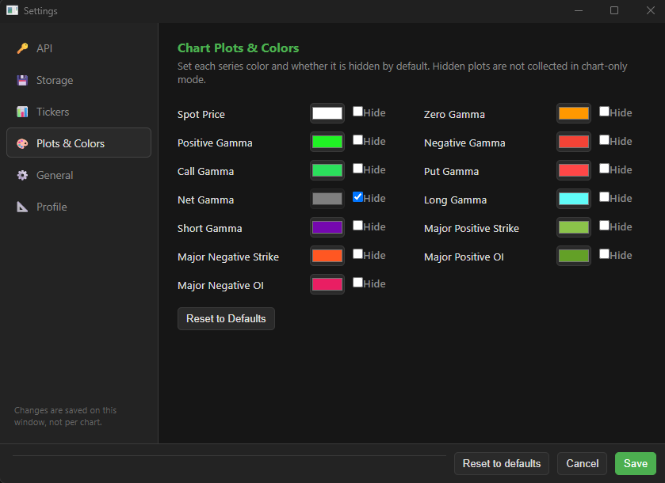

# Market Terminal

<div align="center">
  
</div>

Desktop market-data terminal for the Gexbot API. Go backend, web frontend, SQLite storage, scheduled collection. It keeps a local history of every session so charts and option profiles can be replayed later without calling the API again.

Independent project. Not affiliated with Gexbot. Not financial advice. Read [DISCLAIMER.md](DISCLAIMER.md) before using it.

- [Download a build](https://github.com/lecrackzor/MGT-GO/releases)
- [Changelog](CHANGELOG.md)
- [License](LICENSE) (MIT)

## Requirements

- Windows 10 or 11 with the WebView2 runtime (already present on up-to-date systems).
- A Gexbot API key. Without one the terminal starts, but collection fails.
- Your Gexbot plan decides what can be collected:
  - `Classic` adds spot, zero gamma, and the major volume/OI levels.
  - `State` adds the state ladders and every options-profile greek (delta, gamma, vanna, charm).
  - `Orderflow` adds the orderflow feed; it also includes the greeks.
  - A greek ladder is hidden in the window when the key cannot serve it.
  - The intraday history route (`POST /hist/{ticker}/{package}/{category}`) fills gaps during the day. The end-of-day archive (`/hist/eod`) recovers a session that was missed entirely. Both are on Classic and higher; the intraday route has its own small quota and an 8-hour range cap.

## Install

Download `market-terminal.exe` from the latest [release](https://github.com/lecrackzor/MGT-GO/releases) and run it. There is no installer. Put it in a folder you are happy to keep data in, because session data is written next to the executable.

## Build from source

Requires Go 1.25 and, optionally, [Task](https://taskfile.dev).

```powershell
go-winres make          # regenerate the Windows icon/version resource
go build -ldflags="-H=windowsgui" -o bin/market-terminal.exe .
```

Or, with Task installed:

```powershell
task windows:build      # go-winres make + build, writes bin/market-terminal.exe
task dev                # go run . with a console attached
```

`go-winres` comes from `go install github.com/tc-hib/go-winres@latest`; the icon and version metadata live in `winres/winres.json` and `gex2.ico`. Run `go generate`-free `go-winres make` before a release build, or use `task windows:build`, which does it for you.

The Wails v3 CLI is only needed for `wails3 dev` / `wails3 build`; plain `go build` produces the same program:

```powershell
go install github.com/wailsapp/wails/v3/cmd/wails3@latest
wails3 dev
```

## First run

The startup wizard asks for the API key and which subscription tiers you own. The key is written to `%AppData%\market-terminal\config.yaml`, readable by your Windows account only, and is never handed to a chart window or saved page data. Reopen Settings with the gear button to change the key, tiers, tickers, plots, storage, or profile defaults.

Data collection starts immediately after the wizard for the tickers you keep enabled.

## What it does

**Main window** - one row per enabled ticker with spot, zero gamma, positive and negative gamma levels, net, last update, and open. The header shows the market session, the date, today's API request count for the session, and a backfill chip that opens the log when a recovery pass runs.

**Charts** - a window per ticker and date.



- Header bar with the ticker, date, session pill (with countdown to the next open or close), spot with change, request counter, and a Pin button that keeps the window on top.
- Grouped toolbar: View, Profile, Info, then Reset, Auto-Follow, and Screenshot.
- Clickable series legend. Click a name to hide or show that plot; the choice is stored with the window.
- Crosshair info box with per-series values and deltas, draggable, resizable, pinnable, and collapsible.
- Right-click menu: reset view, auto-follow, lookback dots, levels, alerts, and a Preferences submenu for ticks, price axis, plot order, and per-series colors.
- PNG screenshot of the window, including the docked profile and info panel.

**Option profiles** - Classic, State, Gamma, Delta, Vanna, and Charm ladders at 0 DTE, 1 DTE, and 90 DTE (greeks have no 90 DTE category).

- Dock the profile beside the chart, overlay it on the chart, or detach it into its own window and attach it back later.
- The `Layers` menu chooses which ladders are drawn for that window. Settings chooses which ladders are collected.
- Average or scatter, DTE, price ticks, lookback dots, side, and width stay with the window.
- Replay a session sample by sample at 1x to 64x, or follow the crosshair.

**Settings** - a separate resizable window with these panes:



- `API` - key, subscription tiers, collection mode.
- `Storage` - data directory, retention, end-of-day archive recovery, intraday gap fill, ladder budget, and a pointer to the offline compaction tool.
- `Tickers` - enable, refresh interval, priority, and order per ticker.
- `Plots & Colors` - one grid of plot names with a color swatch and a Hide toggle per row.
- `General` - close or start with the session, time display, file logging, console visibility, zoom filter, right edge.
- `Profile` - defaults for a window that has not chosen its own: side, width, lookback dots, price axis.

Changes are staged until Save. Save applies them to the open windows and closes Settings; Escape and Cancel discard.

## Data on disk

Session data is written next to `market-terminal.exe`, or under the absolute path set in `Storage > Data Directory`.

```text
Tickers 11.19.2026/
  SPX.db            chart rows (spot, gamma levels, and the rest)
  SPX.profiles.db   option ladders, a sibling file that can be copied on its own
  SPY.db
  SPY.profiles.db
```

- `Tickers*/` folders are ignored by Git and never committed.
- Collecting full history for many tickers grows to tens of gigabytes. `Storage > Retention` prunes whole day folders older than the configured number of days; `0` keeps everything.
- The last write of a session optimizes the file and truncates its WAL.
- `cmd/trimprofiles` copies archived folders to the current ladder format, verifies them, and swaps them in. It runs offline, not from the app.

## How collection works

Collection has two halves: live polling while the session runs, and recovery that fills in whatever the poll missed.

**Live polling.** Each enabled ticker polls its endpoints on its own schedule. A ticker with a chart open polls fastest; a ticker with no chart open polls more slowly. `Tickers` in Settings sets the order and can pin an interval per ticker. A ticker marked *archive only* is never polled live — it is collected entirely by the end-of-day recovery, which is the better source for a ticker you are not watching.

**Recovery.** Three passes run on their own, and none of them can overwrite a row that already exists:

| Pass | When | Scope |
| --- | --- | --- |
| Catch-up | at startup | the most recent completed session |
| Intraday gap fill | every 30 minutes while open | live tickers, the elapsed part of today |
| Archive roundup | after the close | every enabled ticker, the full session |

A recovery pass records each session it settles in a small ledger next to the day folders, so a session is downloaded once and not requested again on the next start or the next night.

**Historical majors.** The major call and put gamma levels come from a separate NinjaTrader feed rather than from the chain snapshots. That feed keeps only a short window, so the levels are written into the day files while they are still served — during the day for live tickers, and by each recovery pass for everything else.

## Troubleshooting

- `401` / `403` - the key is wrong or your plan does not include the endpoint. Disabled layers in the chart mean the same thing.
- `429` - the app backs off and pauses that request wave. The request counter in the header shows how much a session is spending.
- Empty chart on a non-trading day - holidays and 1:00 PM early closes are treated as closed, so no session folder is created.
- Nothing collects - check the API key in Settings, then the `Log` button in the main header. File logging can be turned off in Settings.
- Settings will not open - only one instance runs. A second launch focuses the first window.

## Development

```powershell
go test ./...
go vet ./...
go test -race ./...
gofmt -l .
```

CI runs those on Linux and builds for Windows on every push and pull request, in `.github/workflows/test.yml`.

| Path | Contents |
| --- | --- |
| `main.go` | process entry, HTTP asset handler, single-instance guard |
| `app*.go` | Wails app, windows, market clock, backfill wiring |
| `internal/api` | HTTP client, query planning, history routes, and the Gexbot endpoint reference (`README.md`) |
| `internal/coordinator` | collection and merging |
| `internal/database` | chart rows, profile ladders, retention, trimming |
| `internal/scheduler` | per-ticker polling and rate limiting |
| `internal/backfill` | intraday gap fill and end-of-day archive recovery |
| `frontend/` | window UI (main, chart, profile, settings) |
| `cmd/trimprofiles` | offline compaction tool |

## License

MIT. See [LICENSE](LICENSE).
