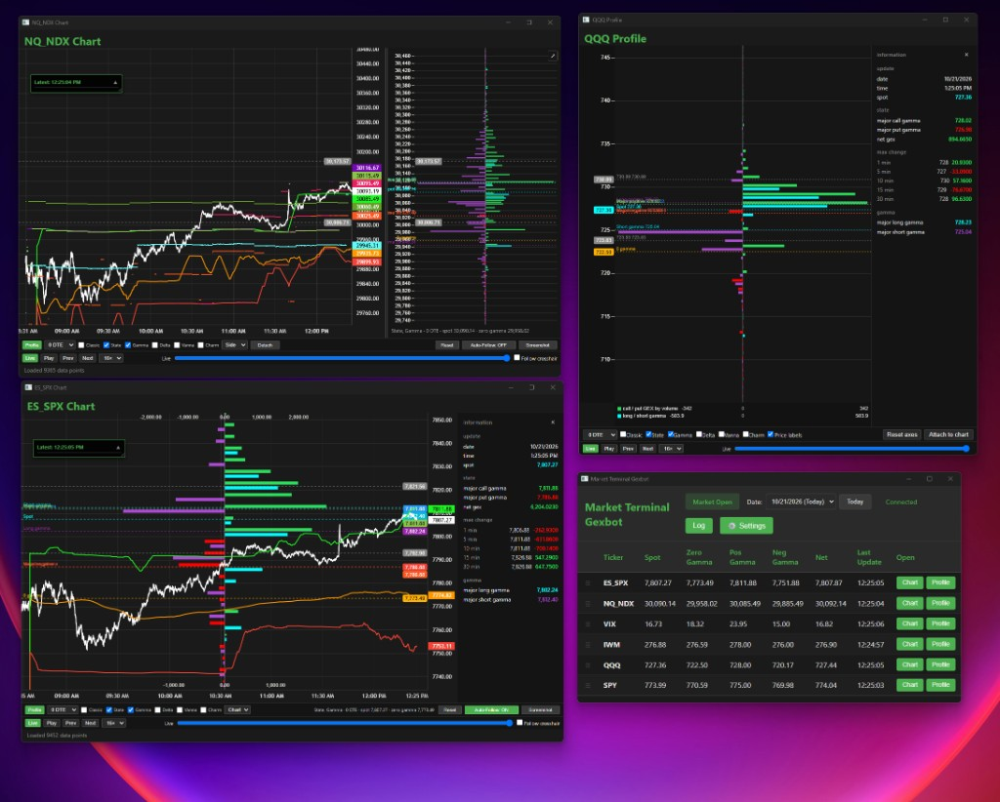

# Market Terminal

<div align="center">
  
</div>

Desktop market-data terminal. Go backend, web frontend, SQLite storage, scheduled collection from the Gexbot API.

This software is not affiliated with Gexbot, is provided as is, and is not financial advice. See [DISCLAIMER.md](DISCLAIMER.md).

## Run

Requires Go 1.25 and the Wails v3 CLI (`go install github.com/wailsapp/wails/v3/cmd/wails3@latest`).

```bash
wails3 dev
wails3 build
```

`wails3 build` writes `build/bin/market-terminal.exe`. A windowed copy can also be built in this folder:

```bash
go build -ldflags="-H=windowsgui" -o market-terminal.exe .
```

The API key is stored in `%AppData%\market-terminal\config.yaml` on Windows (the user config directory on other systems). That file is not committed.

## Layout

- `main.go`, `app.go` — process entry and the Wails app
- `internal/api` — HTTP client and the query list
- `internal/coordinator` — collection and merging
- `internal/database` — chart rows and the sibling profile files
- `internal/scheduler` — polling
- `frontend/` — the window UI
